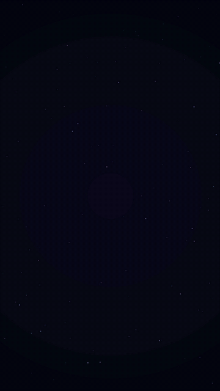
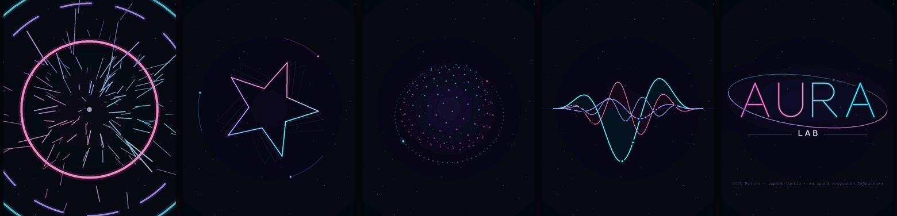

# AURA · motion graphics на turtle

Неоновая моушн-графика, 3D-сфера из частиц и логотип, который собирается из сотен частиц. Всё это нарисовано встроенной библиотекой Python **turtle** — той самой «черепашкой», с которой начинают новички.

Никаких `pip install`: только стандартная библиотека (`turtle`, `math`, `random`, `time`).

<p align="center">
  
</p>



## Запуск

```bash
python3 aura_motion.py
```

Откроется окно 1100×700 с автопоказом пяти сцен. Нужен Python 3.10 или новее.

> **Linux:** если появилась ошибка `No module named 'tkinter'`, установи его: `sudo apt install python3-tk`.
> На Windows и macOS tkinter уже входит в установщик с python.org.

## Сцены

| № | Сцена | Тип | Что происходит |
|---|---|---|---|
| 1 | BIG BANG | конечная | Частицы по спирали затягивает в ядро, затем взрыв: ударные волны, искры со «смазом», тряска камеры |
| 2 | MORPH | конечная | Неоновая фигура превращается из круга в треугольник, квадрат и звезду, схлопывается и «разрезает» экран светом |
| 3 | ORBIT | цикл | 3D-сфера из 190 частиц «дышит» и вращается, вокруг неё наклонное кольцо со спутниками |
| 4 | SIGNAL | цикл | Неоновые звуковые волны, по которым бегут огоньки |
| 5 | AURA | сборка + цикл | Логотип собирается из частиц, обводится неоном, вспыхивает и дальше живёт бесконечно |

## Управление

| Клавиша | Действие |
|---|---|
| `←` `→` | предыдущая / следующая сцена |
| `1` … `5` | перейти к сцене |
| `Space` | пауза |
| `A` | автопоказ вкл/выкл |
| `R` | начать сначала |
| `H` | служебные надписи вкл/выкл |
| `F` | показать FPS |
| `Esc` | выход |

## Вертикальное видео для Reels, Shorts и TikTok

```bash
python3 aura_motion.py --vertical   # окно 9:16
python3 aura_motion.py --reel       # 9:16, без надписей, старт по Space — удобно для записи экрана
```

### Рендер сразу в MP4 (Linux)

Программа может сама собрать ролик 1080×1920, ровно 30 кадров в секунду, без OBS и записи экрана. Каждый кадр рисуется без спешки, поэтому видео получается плавным даже на слабом компьютере.

```bash
sudo apt install xvfb ffmpeg imagemagick        # один раз

python3 aura_motion.py --render reel.mp4                        # все сцены подряд
python3 aura_motion.py --render logo.mp4 --scenes 5 --tail 10   # только логотип
python3 aura_motion.py --render mid.mp4 --scenes 3,4 --loop 6   # сфера и волны по 6 секунд
```

| Флаг | Что делает | По умолчанию |
|---|---|---|
| `--scenes` | какие сцены и в каком порядке | `1,2,3,4,5` |
| `--loop` | сколько секунд показывать каждый цикл | `9` |
| `--tail` | сколько секунд логотип «живёт» после сборки | `8` |
| `--fps` | частота кадров видео | `30` |
| `--size` | размер кадра в пикселях | `1080x1920` |

Xvfb, ffmpeg и ImageMagick — это программы Linux, а не библиотеки Python. Сама анимация по-прежнему использует только стандартную библиотеку: программа рисует кадры на невидимом экране, снимает каждый и передаёт в ffmpeg.

## Как это сделано

Почему это не похоже на turtle, хотя написано только на нём:

1. **Кадр целиком.** `screen.tracer(0, 0)` выключает пошаговую отрисовку. Черепашка рисует кадр невидимо, а `screen.update()` показывает его разом. Так получается анимация, а не ползущая линия.
2. **Время, а не шаги.** Положение каждого объекта считается как функция от времени (`time.perf_counter`), а не «сделай ещё шаг». Плавность дают кривые easing: `ease_out_expo`, `ease_out_back` и другие.
3. **Прозрачность без прозрачности.** В Tk нет полупрозрачных цветов, поэтому «альфа» имитируется смешиванием цвета с фоном (функция `col`). На этом построены затухания и переходы между сценами.
4. **Неоновое свечение.** Каждая линия рисуется несколько раз: широкие тусклые слои снизу, узкая яркая сердцевина сверху. Сначала рисуются слои свечения всех объектов, потом все сердцевины, чтобы ореол одного объекта не перекрывал другой (`glow_lines`).
5. **3D на плоскости.** Точки сферы поворачиваются в пространстве, проецируются с перспективой и рисуются от дальних к ближним (алгоритм художника). Дальние точки мельче и тусклее.
6. **Скорость.** Turtle медленный, поэтому кадр рисуют две черепашки по очереди: старый кадр стирается только после того, как нарисован новый. Так Tk не освобождает и не выделяет заново одни и те же цвета, и отрисовка идёт примерно на треть быстрее.

### Устройство кода

| Часть | Что внутри |
|---|---|
| `clamp`, `lerp`, `ease_*` | математика и кривые плавности |
| `col`, `grad`, `mix` | цвет: «альфа» через смешивание с фоном, фирменный градиент |
| `Pen` | обёртка над черепашкой: ломаные, точки, текст, масштаб кадра |
| `glow_lines`, `glow_dot`, `radial` | неоновое свечение и мягкие пятна света |
| `BigBang`, `Morph`, `Orbit`, `Signal`, `Logo` | пять сцен; у каждой `reset()` и `draw(pen, t)` |
| `App` | окно, клавиши, смена сцен, цикл кадров |
| `render_video` | рендер в MP4 |

## Попробуй сам

Хорошие упражнения, если ты только начал разбираться в коде:

- Поменяй цвета в `PALETTE` и посмотри, как изменятся все сцены сразу.
- В `LETTERS` буквы заданы ломаными. Добавь свою букву и собери из частиц своё имя.
- Сделай шестую сцену: унаследуй класс от `Scene`, опиши `draw(pen, t)` и добавь его в список `self.scenes` в `App`.
- Найди в `Orbit` число частиц сферы и увеличь его. Что происходит с FPS и почему?

## Ещё примеры на turtle

Простые проекты, с которых удобно начинать — фракталы, солнечная система, игры: [eskayML/turtle-projects](https://github.com/eskayML/turtle-projects).

---

Сделано в **[AURA LAB](https://instagram.com/auralab.kg)** — офлайн-школе программирования в Бишкеке.
